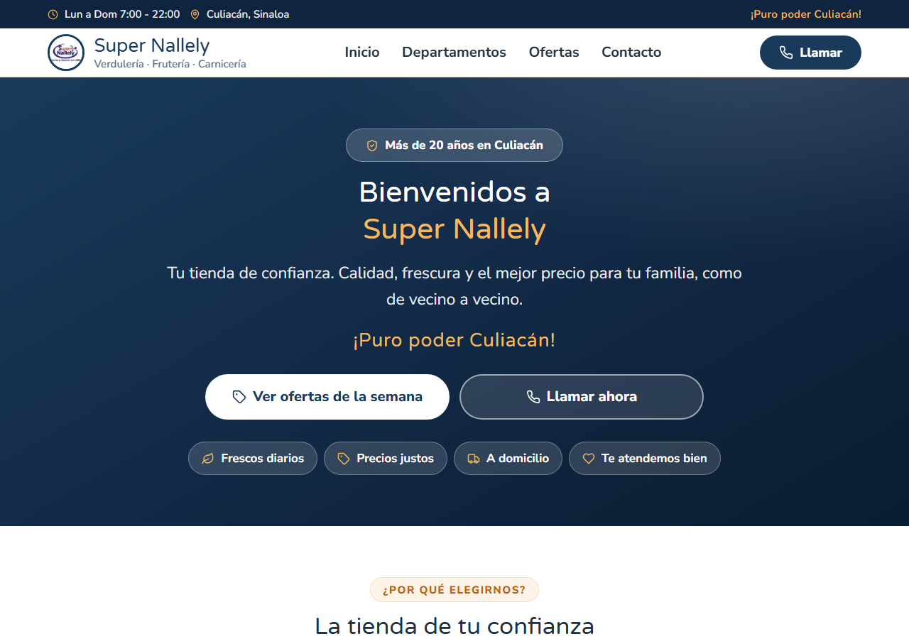
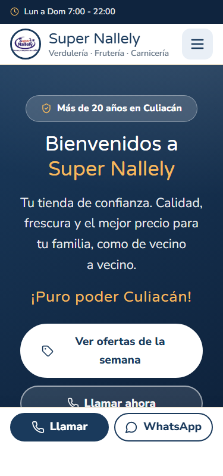

<div align="center">

# 🛒 Super Nallely

### Sitio web oficial de tu tienda de confianza en Culiacán, Sinaloa

*Verdulería · Frutería · Carnicería · Cremería · Abarrotes · Limpieza · Panadería · Bebidas*

**¡Puro poder Culiacán!**

</div>

---

## 📖 Descripción

**Super Nallely** es un supermercado local con más de 20 años sirviendo a las familias
culiacanenses. Este repositorio contiene su sitio web: una página rápida, accesible y
diseñada especialmente para que cualquier persona — sin importar su edad o experiencia
con la tecnología — pueda ver los departamentos, las ofertas de la semana y contactar
a la tienda en un par de toques.

## ✨ Características

- 🎯 **Diseñado para adultos mayores** — tipografía grande (18px base), botones de
  52px de alto, alto contraste y textos claros en español
- 📱 **100% responsivo** — menú hamburguesa en móvil y barra fija de *Llamar* /
  *WhatsApp* siempre visible
- 🏷️ **Ofertas de la semana** con descuento calculado automáticamente (% y ahorro en pesos)
- 🗺️ **8 departamentos** con iconografía propia hecha en SVG
- ☎️ **Contacto directo** — `tel:` y `mailto:` listos para usar desde el celular
- ♿ **Accesibilidad** — navegación por teclado, `focus-visible`, skip link, ARIA labels
  y respeto por `prefers-reduced-motion`
- ⚡ **Rendimiento** — Vite + React, CSS puro sin frameworks, ~75 kB gzipped

## 🛠️ Stack

| Tecnología | Uso |
|---|---|
| [React 19](https://react.dev/) | Interfaz de usuario |
| [TypeScript](https://www.typescriptlang.org/) | Tipado estricto |
| [Vite 8](https://vite.dev/) | Build tool + dev server |
| CSS Custom Properties | Design tokens y theming |
| [Google Fonts](https://fonts.google.com/) | Varela Round + Nunito Sans |

## 🚀 Inicio rápido

```bash
# 1. Clonar el repositorio
git clone https://github.com/EdgarLeonArchuleta19/nallely-web.git
cd nallely-web

# 2. Instalar dependencias
npm install

# 3. Levantar el servidor de desarrollo
npm run dev

# 4. Abrir en el navegador
# http://localhost:5175
```

### Scripts disponibles

| Comando | Descripción |
|---|---|
| `npm run dev` | Servidor de desarrollo con hot reload |
| `npm run build` | Build de producción a `dist/` |
| `npm run preview` | Previsualizar el build de producción |
| `npm run lint` | Análisis estático con oxlint |

## 📁 Estructura

```
src/
├── assets/              # Logo e imágenes
├── components/
│   ├── icons.tsx        # Iconos SVG inline (estilo Lucide)
│   ├── layout/          # Componentes persistentes
│   │   ├── Header.tsx           # Topbar + navegación + CTA teléfono
│   │   ├── Footer.tsx           # Contacto, horarios, redes, pagos
│   │   └── MobileActionBar.tsx  # Barra fija Llamar/WhatsApp (móvil)
│   └── sections/        # Secciones de la página principal
│       ├── Hero.tsx            # Bienvenida + CTAs + badges de confianza
│       ├── WhyUs.tsx           # ¿Por qué elegirnos?
│       ├── Departments.tsx     # 8 departamentos
│       ├── Offers.tsx          # Ofertas de la semana
│       └── CtaBand.tsx         # Banda "Ven a visitarnos"
├── pages/
│   └── Home.tsx         # Composición de la página
└── styles/
    ├── index.css        # Design tokens, reset, estilos base
    └── App.css          # Estilos por componente
```

## 🎨 Sistema de diseño

El diseño se basa en la identidad del logo de la tienda, implementada con CSS
Custom Properties en [`src/styles/index.css`](src/styles/index.css):

| Token | Valor | Uso |
|---|---|---|
| `--brand-navy` | `#1a3a5c` | Color primario (header, hero, botones) |
| `--brand-navy-dark` | `#0f243e` | Footer y barra superior |
| `--brand-orange` | `#e67e22` | Acentos, badges, highlights |
| `--brand-gold` | `#f5b95c` | Detalles sobre fondos oscuros |
| `--background` | `#fdfaf2` | Fondo crema cálido |
| `--foreground` | `#22313f` | Texto principal |

## 📱 Vista previa

<p align="center">
  
</p>
<p align="center">
  
</p>

## 📞 Contacto

**Super Nallely** — Blvd. Pedro Infante #1234, Col. Centro, Culiacán, Sinaloa

🕐 Lun a Dom 7:00 – 22:00 · 📞 667 123 4567 · ✉️ contacto@supernallely.com

---

<div align="center">

Hecho con ❤️ en Culiacán, Sinaloa · 2026

</div>
